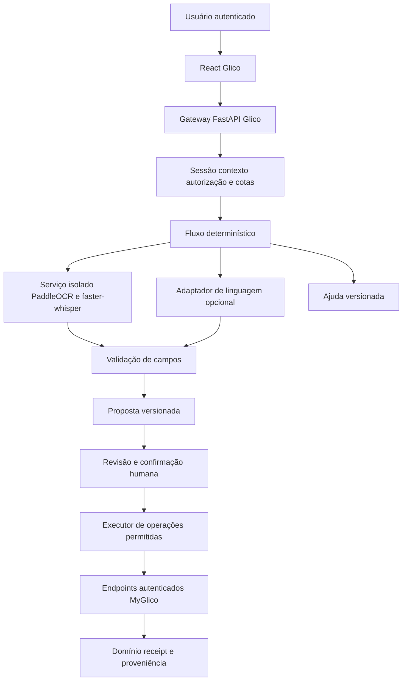

# MyGlico SDD do assistente Glico

**Data:** 13/10/2026  
**Versão:** 1.0  
**Abordagem:** Specification-Driven Development: requisitos, contratos, implementação e validação.  
**Destinatário:** Orca e agentes responsáveis pela implementação.  
**Estado:** especificado; implementação e aceite ainda não executados.  
**Baseline inspecionada:** branch `felipe-cale/impeccable-ux`, commit `e776b9bce55767fdfb58aa8533d34c58465bec8b`. O implementador deve conferir novamente o checkout.

O Glico é um assistente autenticado para operar o MyGlico, consultar dados autorizados e esclarecer o uso da aplicação. O primeiro lançamento usa UCI, dados fictícios e testers internos; segurança, integridade e privacidade são requisitos desde a fase 1. Esse lançamento não representa certificação clínica ou autorização automática para usar qualquer fornecedor com pacientes reais.

O princípio obrigatório é: **o assistente interpreta e prepara; o backend valida e autoriza; o usuário confirma alterações; os endpoints do MyGlico executam**. A fase 1 entrega operações sobre uma leitura e um contexto clínico por vez. A fase 2 acrescenta lotes, arquivos XLSX/CSV e fotos com múltiplas leituras.

## 1. Instruções e precedência

1. Ler `AGENTS.md`, `README.md`, `README.pt-br.md`, `PRODUCT.md`, `DESIGN.md`, os SDDs de autenticação e CSCW e os contratos efetivamente implementados.
2. Este documento especifica uma nova feature. Não interpretar seus comandos como autorização para implementar todas as fases simultaneamente. O prompt de entrega define a fase liberada.
3. Preservar as invariantes existentes de contas, vínculos, investigações, fuso, criptografia e proveniência. Nomes novos são contratos propostos; ajustes precisam ser registrados em decisões de arquitetura, com atualização de consumidores e testes.
4. Não copiar a exclusão histórica de IA/anexos do escopo do SDD CSCW como proibição desta feature. O Glico é uma extensão separada; mensagens de investigação continuam no mecanismo atual.
5. Não modificar migrações aplicadas. Criar migrações explícitas e progressivas; validar SQLite com foreign keys e MySQL 8.
6. Não escrever credenciais, dados reais, anexos de usuários ou transcrições em documentos, fixtures ou evidências.
7. O implementador não pode declarar uma fase pronta com testes simulados como única evidência de OCR ou transcrição real. Separar testes de contrato, testes adversariais e testes dos modelos.
8. Os IDs normativos `GLI-*` devem ser preservados em código de testes, matriz e evidências. Um ajuste não pode reduzir autorização, confirmação, descarte ou controle de custo por conveniência.

## 2. Base existente e ajustes necessários

| Área | Estado observado | Consequência da implementação |
| --- | --- | --- |
| Autenticação | Sessão revogável em cookie HttpOnly, Secure, SameSite=Lax; `SessionPrincipal` resolvido do banco | Reusar a sessão; nunca criar credencial administrativa para o assistente |
| Contas | Cada conta é Patient ou Doctor, com papéis exclusivos | Papel e domínio são derivados do servidor |
| Autorização | `_require_patient_access` e `_scoped_patient_ids`; médico precisa de vínculo ACTIVE | Aplicar também a conversas, propostas, jobs, downloads e resultados |
| Registro manual | `create_manual_glucose_record` grava origem, evento, métricas básicas e pending; faz commit próprio | Refatorar cuidadosamente a fronteira transacional para idempotência e receipt |
| Investigações | Participantes específicos, associação histórica, versão e idempotência de mensagens | Não reutilizar conversas de outro médico ou ciclo de vínculo anterior |
| PDF | Endpoint autenticado por paciente, período e `lang` | Entregar link interno validado; não enviar o PDF ao modelo |
| Análises | Básicas online; anomalias/clusters offline; status stale/updating | Nunca apresentar classificação pendente como resultado atual |
| Dias atípicos | A rota seleciona flags da última análise sem filtro explícito de freshness | Harmonizar o endpoint com freshness antes de ligá-lo ao Glico |
| Origem UCI | `RawImportRecord.raw_payload` é texto em claro | Não reutilizar esse campo para fotos, áudio, planilhas ou texto bruto de testers |
| Limites | `rate_limit.py` é local ao processo e cobre poucos endpoints | Implementar limite compartilhado para a feature |
| Infraestrutura | Vercel configurada com `maxDuration=30`; cliente JSON com timeout de 20 s | OCR e ASR em serviço dedicado; deadlines explícitos e novos helpers de transporte |
| Interface | `PatientHome` e `DoctorHome` em `OverviewPage.jsx`, React 18, três locales | Integrar as duas superfícies preservando design e funções existentes |

Referências locais: `app/core/security.py`, `app/core/crypto.py`, `app/core/CRYPTO_CONFIGURATION.md`, `app/api/routes.py`, `app/services/manual_entry.py`, `app/services/investigations.py`, `app/services/doctor_links.py`, `app/services/reports.py`, `app/services/daily_metrics.py`, `app/models/entities.py`, `frontend-react/src/api.js` e `vercel.json`.

## 3. Fases e dependências

| Entrega | Conteúdo obrigatório | Dependência | Critério para liberar |
| --- | --- | --- | --- |
| F1.0 Fundação | Contratos, sessão, contexto, limites compartilhados, propostas, confirmação, receipt, descarte, gate de provedores | Inspeção da baseline | Testes de autorização, atomicidade, CSRF e replay passam |
| F1.1 Foto individual | PaddleOCR, extrator substituível, uma leitura, edição e orientação quando ambígua | F1.0 | OCR real e descarte demonstrados com fixtures sintéticas |
| F1.2 Texto e consultas | Registro individual, PDF, métricas, dias atípicos, notificações, vínculos em leitura, FAQ e navegação | F1.0 | Contratos e E2E para os dois papéis e três locales |
| F1.3 Áudio | faster-whisper multilíngue, texto temporário, registro e comandos dos dois papéis | F1.0 e contratos de F1.2 | ASR real, números/datas e limites testados em pt-BR/en-US/es |
| F1.4 Colaboração e integração | Abrir questionamento, preparar mensagem, confirmar envio; UI final mobile/desktop | F1.1 a F1.3 | Toda a matriz F1 passa; revisão independente sem bloqueadores |
| F2 Lotes | XLSX/CSV, templates, fotos de várias leituras, revisão e gravação atômica de lote | F1 aprovada | Toda a matriz F2 passa, inclusive ZIP bombs e rollback |
| F3 Evoluções | Consultas agregadas de vários pacientes, confirmação por voz e eventuais questionários estruturados | Nova autorização de escopo | Nova especificação; não implementar por inferência |

F1.0 a F1.4 são incrementos da mesma fase 1, não autorização para lançar segurança parcialmente implementada. O primeiro incremento funcional prioriza PaddleOCR. Áudio e consultas podem ser desenvolvidos em paralelo após estabilizar os contratos. A fase 2 não é necessária para aceitar a fase 1.

### 3.1 Escopo que não deve entrar por inferência

Google Sheets, URLs de arquivos, navegação livre na web, agentes de programação, shell, Python gerado pelo modelo, SQL gerado, diagnóstico, sugestão autônoma de tratamento, prescrições, notificações externas, edição/exclusão de glicemias, registro de glicemia pelo médico e alteração de vínculos via agente ficam fora de F1/F2. Vínculos permanecem operáveis pela interface existente; o Glico pode consultar e abrir essa interface.

Questionamento significa a investigação/conversa CSCW existente. Um questionário estruturado com formulário, pontuação e perguntas clínicas seria outro recurso. Leitura em lote de pacientes diferentes pelo médico fica em F3; listar seus pacientes autorizados continua em F1.

## 4. Requisitos funcionais

### 4.1 Paciente

- **GLI-FUN-01:** integrar Glico à página inicial autenticada; manter acesso ao registro manual, painel, investigações e vínculos mesmo com Glico indisponível.
- **GLI-FUN-02:** texto livre sobre uma glicemia deve produzir campos estruturados ou perguntas para completar informações; nenhum registro automático.
- **GLI-FUN-03:** uma foto deve gerar uma proposta editável de uma leitura, sem armazenamento do anexo.
- **GLI-FUN-04:** áudio pode estar em qualquer um dos três idiomas, independentemente do idioma da interface; identificar idioma, transcrever e interpretar sem traduzir silenciosamente valores.
- **GLI-FUN-05:** gerar pedido de PDF com paciente, período concreto e idioma; disponibilizar download interno autenticado.
- **GLI-FUN-06:** consultar leituras, resumo, métricas, dias atípicos, pendências e questionamentos próprios; origem do número é sempre resultado do backend.
- **GLI-FUN-07:** abrir questionamento com médico escolhido entre os vínculos ativos; título, mensagem e dias associados aparecem para revisão antes de enviar.
- **GLI-FUN-08:** preparar resposta em investigação própria e confirmar conteúdo/destinatário antes de chamar o endpoint.
- **GLI-FUN-09:** consultar vínculos e notificações e oferecer navegação interna; não alterar consentimentos por inferência.
- **GLI-FUN-10:** responder dúvidas de uso com base de ajuda versionada e localizadas.

### 4.2 Médico

- **GLI-FUN-11:** listar/localizar apenas seus pacientes autorizados usando o endpoint existente; identificação ambígua deve pedir seleção.
- **GLI-FUN-12:** ter no máximo um contexto clínico selecionado por conversa; exibir paciente e período. Uma conversa sem paciente permite apenas ajuda e listagem autorizada.
- **GLI-FUN-13:** consultar métricas, leituras, dias atípicos e PDF do paciente selecionado com vínculo ativo atual.
- **GLI-FUN-14:** abrir investigação e preparar mensagem apenas nos recursos que o médico pode acessar. Usar o ciclo de associação e as permissões de participante existentes.
- **GLI-FUN-15:** consultar respostas/não lidas das suas investigações. Um vínculo não concede acesso às conversas dirigidas a outro médico.
- **GLI-FUN-16:** aceitar comandos e ditado nos três idiomas; criação/envio seguem a mesma revisão da entrada digitada.
- **GLI-FUN-17:** nunca oferecer registro de glicemia em nome do paciente na fase 1 ou 2; chamadas diretas devem ser negadas no backend.

Em F1/F2, foto para extração de glicemia é capacidade do Patient. No Doctor, ocultar essa entrada e negar extração de leitura antes de chamar OCR; áudio continua permitido para consultas/ditado. Não cobrar processamento de imagem para produzir uma proposta que o papel não poderá executar.

### 4.3 Reconhecimento e esclarecimento

- **GLI-FUN-18:** distinguir valor glicêmico de horário, data, número de série, memória, média e outros números da tela. Se não for possível, pedir correção/nova foto.
- **GLI-FUN-19:** se foto ou mensagem contiver múltiplas leituras em F1, informar que lotes ainda não estão disponíveis, oferecendo selecionar/preencher uma única leitura. Não escolher automaticamente o maior número ou a última linha.
- **GLI-FUN-20:** nenhum campo obrigatório ausente pode ser inventado. Uma sugestão de data/hora atual só é válida como sugestão visível, que o usuário deve revisar e confirmar.
- **GLI-FUN-21:** sinais como HI/LO, imagem ilegível e unidade não reconhecida não devem virar glicemia numérica inventada.
- **GLI-FUN-22:** fuso vem do Patient no servidor. Datas relativas devem mostrar o intervalo resolvido; DD/MM e MM/DD ambíguos exigem pergunta. Dados históricos UCI não são deslocados para o presente.

## 5. Experiência, idiomas e acessibilidade

**GLI-UX-01:** suportar pt-BR, en-US e es em todas as mensagens fixas, rótulos, erros, estados, templates e instruções de captura. Idioma de áudio não altera automaticamente o idioma da interface.

**GLI-UX-02:** em mobile a partir de 390 px, conversa, entrada e cartões não têm overflow horizontal. Usar composer acessível com teclado aberto, safe areas e alvos de toque de pelo menos 44 por 44 px. Lotes em F2 usam cartões/linhas adaptadas; tabela larga só no desktop.

**GLI-UX-03:** em desktop, usar o espaço para histórico da sessão e revisão. No contexto médico, seletor de paciente visível. Mostrar nome de exibição, SHORTID autorizado, período e estado da análise; nunca depender apenas de cor.

**GLI-UX-04:** revisão individual inclui valor, unidade original, valor normalizado quando convertido, data, hora, fuso, contexto, observações e indicação do que foi sugerido/corrigido. Confiança do OCR não substitui confirmação.

**GLI-UX-05:** gravação começa somente por ação explícita. Oferecer iniciar, parar, ouvir, excluir e enviar; sem gravação em background. Encerrar tracks do microfone ao sair/cancelar. Recusar microfone/câmera não impede digitação/anexo de arquivo.

**GLI-UX-06:** em F1/F2 confirmar pelo botão inequívoco da proposta. Um "sim" digitado ou reconhecido por ASR não executa; direcionar ao cartão. Confirmação por voz só entra em F3 com especificação adicional.

**GLI-UX-07:** estados obrigatórios: vazio, processando, aguardando esclarecimento, proposta pronta, corrigindo, confirmando, concluído, cancelado, expirado, limite, sessão expirada, vínculo revogado, falha de reconhecimento e falha de execução. Não mostrar sucesso antes de um receipt persistido.

**GLI-UX-08:** foco, navegação por teclado, anúncio moderado de resultados, contraste, labels e mensagens equivalentes em leitores de tela; não anunciar cada token de streaming. Desabilitar visualmente duplo clique é complemento à idempotência do backend.

**GLI-UX-09:** usar carregamento local no chat. Não bloquear a aplicação inteira durante OCR/ASR. Após registro, atualizar última leitura e áreas afetadas, mantendo status pendente quando aplicável.

**GLI-UX-10:** históricos livres ficam voláteis nesta versão. Reload reconstitui apenas propostas/resultados estruturados ainda autorizados, nunca uma transcrição integral. Informar esse comportamento ao usuário.

## 6. Arquitetura e fronteiras de confiança



### 6.1 Gateway e executor

**GLI-ARC-01:** o gateway controla a sessão, contexto, fluxo, orçamento e formato. O modelo não recebe cookie, senha, chave de API, configuração criptográfica, session ID ou banco. O executor é código com registro explícito de operações, sem URLs/métodos livres.

**GLI-ARC-02:** acesso clínico acontece pelos endpoints autenticados MyGlico. Em aplicação única, usar transporte HTTP interno/in-process com rotas fixas; propagar a sessão vigente apenas dentro desse transporte confiável. O adaptador não deve acessar o banco clínico, nem chamar serviços clínicos diretamente para contornar a camada HTTP.

**GLI-ARC-03:** a persistência de conversas, propostas, receipts e cotas pertence ao backend. O acesso a essas tabelas pelo gateway não representa acesso clínico livre do modelo. O serviço de OCR/ASR não tem acesso a esse banco.

**GLI-ARC-04:** operações de domínio precisam participar da integridade de execução descrita na seção 9. Chamadas HTTP independentes com commit clínico seguido de gravação separada de receipt não satisfazem a atomicidade.

### 6.2 Processamento de mídia

**GLI-ARC-05:** PaddleOCR e faster-whisper ficam em um serviço dedicado com modelos provisionados previamente. Não adicioná-los automaticamente às dependências base da função Vercel. O serviço mantém modelos em memória; payloads do usuário são temporários por requisição.

**GLI-ARC-06:** comunicação backend-serviço por TLS e autenticação de serviço. Usar assinatura curta com request ID aleatório, expiração, método/path permitidos e digest do corpo; nonce de uso único. Não encaminhar cookie de paciente, IDs clínicos, nome, e-mail ou chaves do banco. O endpoint de inferência não é publicamente acessível sem autenticação.

**GLI-ARC-07:** replay e cotas internas são compartilhados entre réplicas. Serviço limita concorrência, tamanho, duração, deadline e processo filho. O request deve poder ser abortado e o processo interrompido. Timeout do HTTP client sozinho não encerra inferência em background.

**GLI-ARC-08:** sem acesso a shell genérico, rede arbitrária ou filesystem de produção. Bibliotecas/modelos vêm de versões e digests aprovados; não baixar modelos por nome/URL fornecido pelo usuário. Arquivos de modelo são recursos da aplicação, não anexos clínicos.

### 6.3 Adaptadores

| Contrato proposto | Entrada | Saída e autoridade |
| --- | --- | --- |
| `ReadingExtractor` | Bytes de imagem limitados e opções validadas | Elementos detectados, posições e campos candidatos; não cria registro |
| `SpeechProvider` | Bytes de áudio limitados e idiomas permitidos | Texto e idioma em memória; sem persistência de transcrição |
| `IntentProvider` | Texto limitado, contexto mínimo e intenções permitidas | Intenção tipada e argumentos candidatos; sem executar ferramentas |
| `HelpProvider` | Pergunta e guias publicados da versão | Resposta fundamentada com IDs de ajuda e links permitidos |
| `FileReader` F2 | Bytes XLSX/CSV e limites | Linhas normalizadas em memória, mapeamento e problemas |
| `MyGlicoToolGateway` | Contexto autorizado e argumentos validados | Resultado de endpoint permitido; nunca depende de permissão decidida pelo modelo |

**GLI-ARC-09:** schemas Pydantic com `extra=forbid`, enums e limites explícitos. Saídas do modelo são dados não confiáveis e passam pela mesma validação de uma entrada adulterada. Frameworks e SDKs não podem aprovar ações sozinhos.

**GLI-ARC-10:** uso de linguagem externa é opcional e configurado pelo servidor; fluxo Python cobre os comandos documentados e a FAQ básica sem fornecedor. Linguagem não reconhecida exige esclarecimento, não interpretação inventada. Ativar fornecedor adiciona tratamento de pedidos livres, sem mudar a política de ferramentas.

## 7. Autorização e contexto clínico

### 7.1 Invariantes

- **GLI-SEC-01:** cada endpoint Glico resolve sessão ativa, conta ativa e papel no servidor. Sessão inválida retorna 401 antes de invocar modelo ou serviço de mídia.
- **GLI-SEC-02:** contexto Patient é sempre o Patient da sessão; payloads de modelo não podem fornecer `patient_id`, `actor_user_id`, papel ou account ID.
- **GLI-SEC-03:** Doctor seleciona paciente por controle específico. O backend valida vínculo ACTIVE e registra o `association_id` exato no contexto. Um ID de paciente enviado nessa operação é seleção, não autorização.
- **GLI-SEC-04:** conversa pertence a uma conta; proposta pertence à mesma conta/conversa/contexto. Recursos ausentes e alheios retornam o mesmo 404 genérico, sem nomes ou metadados.
- **GLI-SEC-05:** role, ownership, vínculo, associação histórica e participação em investigação são verificadas em cada leitura, atualização, execução, polling e download, não só ao abrir o chat.
- **GLI-SEC-06:** médico perde acesso a resultados clínicos e propostas após revogação. Reassociação cria novo contexto/ciclo; não reabre o histórico protegido do vínculo antigo.
- **GLI-SEC-07:** contexto tem `context_version`; troca de paciente ou período invalida propostas dependentes do contexto antigo. A atualização usa compare-and-swap; abas concorrentes não podem misturar pacientes.
- **GLI-SEC-08:** caches, contexto do modelo, queries e resultados são isolados por conta, papel, paciente, association ID e versão. Não há memória clínica global nem índice vetorial compartilhado de anexos.

### 7.2 Revogação durante processamento

Revalidar acesso antes de iniciar, antes de montar contexto para um fornecedor, depois de retornar de OCR/ASR/modelo e antes de responder/executar. Se vínculo ou sessão mudar, descartar o resultado e não devolver dados clínicos. Não manter locks de banco durante inferência ou chamadas externas.

**GLI-SEC-09:** serializar execução de escrita com revogação do vínculo e da sessão, com locks na mesma ordem documentada. Revogação que confirma primeiro impede a operação; operação que confirma primeiro era autorizada naquele instante. Testar ambas as ordens no MySQL. Não prometer desfazer conteúdo já visto/baixado legitimamente antes da revogação.

**GLI-SEC-10:** a UI apaga contexto sensível ao logout, troca de conta, revogação detectada e troca de paciente. Não persistir chat clínico em localStorage, IndexedDB, service worker ou analytics. Consultas posteriores continuam protegidas mesmo se o frontend estiver adulterado.

### 7.3 Segurança de transporte e navegador

**GLI-SEC-11:** endpoints Glico usam `Cache-Control: no-store, private`; qualquer streaming, erro, template autenticado e resposta de mídia também. Acrescentar novas rotas à política atual. Proxies/CDN não armazenam esses corpos.

**GLI-SEC-12:** aplicar CSRF em todas as operações Glico com efeito, inclusive processamento caro: Origin/Referer contra origem exata configurada e token CSRF ligado à sessão em header customizado. Rejeitar Origin ausente/nulo para chamadas de navegador; transporte interno usa autenticação/capabilidade própria verificada, nunca dispensa CSRF só porque existe um header vindo do cliente. SameSite sozinho não basta.

**GLI-SEC-13:** CORS sem wildcard com credenciais; TLS; cookies atuais preservados; `X-Content-Type-Options: nosniff`; links de navegação/download produzidos por construtor interno. Não fazer fetch de URLs sugeridas pelo modelo. A política CSP deve restringir scripts/conexões conforme a aplicação.

**GLI-SEC-14:** renderizar texto com escaping, sem HTML arbitrário, scripts, iframes ou imagens externas em respostas. Markdown, se usado, deve ser sanitizado com protocolo/domínio permitido e sem recursos remotos que exfiltram dados.

## 8. Threat model e limites do modelo

| Ameaça | Ativo afetado | Barreira obrigatória | Prova de aceite |
| --- | --- | --- | --- |
| IDOR em conversa/proposta/job | Dados e ações de outra conta | Ownership + autorização por recurso | Adulterar IDs em todos os endpoints |
| Médico sem vínculo ou ciclo antigo | Dados/conversas de paciente | ACTIVE + association ID + participante | Revogar e reassociar mantendo IDs anteriores |
| Injection em texto/áudio/foto/célula | Ferramentas, contexto, confirmação | Extração isolada + schemas + registro de ferramentas + executor | Modelo stub comprometido tenta ferramenta proibida |
| Confirmação forjada/replay | Glicemia/mensagem duplicada | Proposta versionada + confirmação externa ao modelo + receipt atômico | Concorrência e perda de resposta |
| Contaminação de contexto | Paciente incorreto | context version + escopo por ciclo | Troca A/B durante chamada em andamento |
| CSRF | Sessão e orçamento | Origin + token de sessão + POST tipado | Form/upload cross-origin |
| SSRF/exfiltração | Rede e dados | Sem URLs livres + egress restrito | URL interna, redirect e URL em saída do modelo |
| Mídia malformada/descompressão | Disponibilidade | Limites antes/durante decode + sandbox | Imagem enorme, áudio longo, ZIP bomb |
| Denial of wallet | Orçamento | Reserva atômica, limites compartilhados e deadline | Requisições simultâneas em réplicas |
| Logs/traces/backups | Anexos e texto sensível | Logging allowlist + proibição de body capture | Busca de marcadores sintéticos em destinos |
| Dependência/modelo comprometido | Host e resultado | Versões/digests, isolamento e revisão de dependências | Artefato inválido e instalação sem egress livre |

**GLI-SEC-15:** não prometer imunidade universal a prompt injection. O requisito é que um modelo induzido ou comprometido não ultrapasse permissões, orçamento ou confirmação. Uma resposta textual de recusa não prova que nenhum efeito ocorreu; testes verificam chamadas, banco e egress.

**GLI-SEC-16:** tratar transcrição, OCR, células, mensagens de investigação, observações e resultados textuais de ferramentas como conteúdo, nunca novas instruções de sistema. Notas clínicas podem conter frases imperativas legítimas; não apagar dados indiscriminadamente por keyword. Descartar/recusar instruções de controle extraídas, sem alterar observações que o usuário explicitamente revisar e confirmar.

**GLI-SEC-17:** classificar pedido antes de chamadas caras quando possível. Admitir intenções documentadas, pedir esclarecimento se incerto e responder brevemente a pedidos fora do escopo. Não liberar shell, Python, SQL, pesquisa web ou ferramentas por pedido do usuário/modelo. Em áudio pode haver custo de ASR antes de identificar o assunto; duração e cotas limitam esse custo.

**GLI-SEC-18:** nenhum score de confiança, segundo LLM, guardrail, instrução de prompt ou schema substitui autorização/consentimento. Não permitir ferramenta `confirm`, `approve`, `commit`, `change_role` ou equivalente ao modelo.

**GLI-SEC-19:** biblioteca de ajuda é publicada/revisada com o código. Documentos privados de configuração e segredos não entram no corpus. Anexos, mensagens de pacientes e resultados de testes não são automaticamente aprendidos, compartilhados ou usados em treinamento.

## 9. Propostas, confirmação e execução exatamente uma vez

### 9.1 Máquina de estados

| Estado | Significado | Transições permitidas |
| --- | --- | --- |
| DRAFT | Faltam campos/validações | READY, CANCELLED, EXPIRED |
| READY | Conteúdo validado e revisável | Nova versão DRAFT/READY, EXECUTED por confirmação, CANCELLED, EXPIRED, INVALIDATED |
| EXECUTED | Efeito e receipt confirmados na mesma transação | Terminal; retries retornam o receipt autorizado |
| CANCELLED | Usuário cancelou | Terminal |
| EXPIRED | TTL terminou | Terminal; gerar nova proposta explícita |
| INVALIDATED | Contexto/permissão/precondição mudou | Terminal |

Estados visualmente "confirmando"/"processando" não significam que a escrita foi confirmada no banco. Não deixar proposta permanentemente EXECUTING depois de crash. Um lease técnico, se necessário, tem TTL e não autoriza um segundo efeito.

### 9.2 Integridade da confirmação

- **GLI-SEC-20:** confirmação ocorre em endpoint específico por ação explícita do usuário, com CSRF, `version`, `context_version` e chave de idempotência. O endpoint não aceita campos clínicos editados junto da confirmação; editar é operação separada que gera nova versão.
- **GLI-SEC-21:** hash canônico inclui operação, argumentos normalizados, paciente, destinatário/associação quando aplicável, conta, versão, contexto e versão do normalizador. O servidor calcula o hash; cliente/modelo não define o conteúdo final ou paciente autorizado.
- **GLI-SEC-22:** ao confirmar, resolver novamente sessão, propriedade, papel, vínculo, contexto, recursos referenciados, freshness e pré-condições. Uma aprovação antiga não acompanha mudança de destinatário, valor, período, unidade ou conjunto de linhas.
- **GLI-SEC-23:** duas confirmações da mesma proposta/versão, mesmo com chaves diferentes, produzem no máximo um efeito. Usar unicidade de execução por proposta/versão; reutilizar chave com conteúdo diferente retorna 409.
- **GLI-SEC-24:** retry de uma execução concluída devolve apenas receipt após autorização atual. Um médico revogado recebe negação, não o receipt clínico histórico. Perda da resposta não autoriza repetir o efeito.

### 9.3 Integração transacional com os endpoints

O gateway monta a chamada para um endpoint fixo e propaga a sessão vigente no transporte confiável. A confirmação pode emitir uma capabilidade interna curta, assinada, específica para proposta/versão/operação/argumentos. Essa capabilidade não é credencial geral, não sai para o modelo/worker e não pode ser criada por headers arbitrários do navegador.

**GLI-SEC-25:** o endpoint de domínio verifica capabilidade, sessão e escopo; trava a proposta/versão; valida o digest dos argumentos; executa mutação, origem, métricas necessárias, eventos e receipt numa única transação e marca EXECUTED. Se qualquer passo falha, tudo faz rollback e a proposta continua sem efeito. As operações diretas existentes preservam seus contratos e permissões; não ganham privilégios por aceitar metadados Glico.

**GLI-SEC-26:** remover commits internos somente onde necessário, com funções transacionais reutilizadas pelos endpoints, mantendo compatibilidade do registro manual e CSCW. Nunca fazer commit clínico em HTTP A e depois tentar garantir idempotência em HTTP B. Se a arquitetura mudar, documentar como efeito e receipt permanecem atomicamente acoplados.

**GLI-SEC-27:** envio de mensagem e abertura de investigação geram uma única notificação/evento de sucesso por efeito. Usar receipt e idempotência junto da operação; IDs da investigação/médico/dias devem pertencer ao contexto atual.

**GLI-SEC-28:** confirmação só usa campos considerados READY; campos inválidos, NaN/Infinity, datas irresolvidas e unidade desconhecida bloqueiam a operação. Validar `0 < glucose_mg_dl <= 1000`, conforme API atual; isso é limite técnico, não diagnóstico. Conversão de mmol/L é determinística, documentada, testada e exibida antes de confirmar, conservando unidade/valor original nos dados estruturados protegidos.

## 10. Anexos, transcrições e descarte

### 10.1 Política obrigatória

**GLI-PRV-01:** anexos existem apenas em memória durante extração. Proibir banco, objeto em bucket, Blob Vercel, disco temporário, fila com bytes, backups, logs, traces, dumps de request e compartilhamento em corpus. Transcrição integral e texto bruto do OCR/planilha têm a mesma política.

**GLI-PRV-02:** não usar `UploadFile`/multipart com spool automático em disco sem controle comprovado. Preferir request binário com `request.stream()` limitado, tipo explícito e headers/contexto pequenos. Proxy, framework e SDK também não podem gravar corpo. Content-Length não é fonte confiável; contar os bytes efetivamente recebidos.

**GLI-PRV-03:** validar antes do decode e impor limites durante decode. Um JPEG pequeno com dimensão enorme é rejeitado. Tratar MIME declarado, magic bytes, extensão e container; filename não entra em path/command/log. Desabilitar imagens animadas e conteúdo ativo.

**GLI-PRV-04:** converter orientação/EXIF em memória e remover metadados da imagem processada. Em mobile, formatos não aceitos devem ser convertidos localmente ou receber orientação; não passar HEIC arbitrário a decoders sem limite. Nunca armazenar original para "melhorar o modelo".

**GLI-PRV-05:** `finally` libera buffers, referências e object URLs. Gravação/cancelamento encerra microfone. Processos isolados têm deadline e encerramento; desabilitar swap persistente e core dumps onde a infraestrutura permitir. Não prometer apagamento forense de cada byte em RAM; a garantia verificável é ausência de persistência e término do processamento.

**GLI-PRV-06:** recusar configurações que exijam salvar mídia em disco. Quando decoder aceita stream, usar BytesIO/pipe com argumentos fixos. Não invocar shell por nome de arquivo. Se a biblioteca não puder cumprir a política, trocar o adaptador ou manter a capacidade desabilitada.

**GLI-PRV-07:** nenhuma fila durável referencia upload em storage. Jobs podem guardar metadados mínimos, deadline e estado; se o processo for perdido, a UI pede reenvio. Reenvio não repete gravação já confirmada graças ao receipt.

### 10.2 O que pode ser persistido

| Informação | Regra |
| --- | --- |
| Áudio/foto/XLSX/CSV e filename original | Proibido |
| Transcrição completa, OCR completo, texto de células não selecionadas | Proibido |
| Texto livre digitado no chat | Volátil em F1/F2; não criar armazenamento de histórico livre |
| Campos de proposta necessários à revisão | Payload criptografado, TTL, ownership e escopo por associação |
| Mensagem ditada escolhida para envio | Apenas conteúdo final revisável da proposta, criptografado; após confirmar, mensagem normal do domínio |
| Resultado clínico de consulta | Preferir reconstrução autorizada; não manter cópia persistente da resposta inteira |
| Registro confirmado e observações | Persistência do domínio com a proteção existente |
| Operação, versões, IDs internos, origem e receipt | Persistência mínima privada; sem valores/texto bruto em metadata JSON |
| Métricas operacionais | Contagens, duração, tamanho aproximado, versão do motor e código de erro; sem conteúdo |

**GLI-PRV-08:** mensagem final ditada pode coincidir com o trecho de fala que o usuário pretende enviar. Isso é conteúdo de domínio explicitamente revisado, não armazenamento da transcrição bruta, timestamps/diarização ou fala descartada. Não persistir o áudio nem o restante da transcrição.

**GLI-PRV-09:** proposta criptografada usa AES-GCM/AAD de tabela, coluna e ID, seguindo mecanismo atual. Persistir temporariamente dados estruturados não autoriza JSON plaintext de notas, mensagens, linhas de CSV ou valores clínicos no audit trail.

**GLI-PRV-10:** drafts expiram após 15 minutos; payload de proposta concluída/cancelada/invalidada deve ser apagado no máximo em 24 horas. Sanitizar imediatamente payloads após revogação, mantendo apenas tombstones e referências autorizáveis. Cleanup também roda em scheduler externo; não depender de loop serverless. Backups contêm apenas dados permitidos criptografados; restaurar deve aplicar expirations antes de expor o serviço. Dados de domínio seguem sua retenção existente.

**GLI-PRV-11:** UI avisa que reload pode perder texto/áudio ainda não enviado, não guarda anexo para retomar e não promete reconstituição fiel da mídia descartada. Metadados de extração documentam versão/método sem fingir que o arquivo original foi preservado.

### 10.3 Fornecedores externos

**GLI-PRV-12:** faster-whisper e PaddleOCR são executados sob controle da aplicação por padrão. Egress de payload para fornecedor externo só com configuração explícita, propósito definido, minimização e política de retenção compatível. Não usar Files API ou equivalente que persista anexos.

**GLI-PRV-13:** nenhum fallback automático pode mudar fornecedor, região, retenção ou finalidade. Não encaminhar mídia quando OCR/ASR local falhar; orientar o usuário. Texto minimizado só vai ao adaptador de linguagem aprovado; nomes/IDs diretos e dados clínicos desnecessários são removidos. SDKs/tracing sem captura de mensagens.

**GLI-PRV-14:** licença pessoal Google AI Pro não é credencial de API da aplicação nem comprova elegibilidade de uso clínico. Antes de ativar serviço externo registrar finalidade, termos vigentes, configuração de billing e retenção. Nesta entrega, testar com dados sintéticos; transição a pacientes reais exige revisão específica das condições do fornecedor e proteção de dados.

## 11. OCR e transcrição

### 11.1 PaddleOCR

**GLI-MED-01:** implementar um adaptador PaddleOCR com import lazy no serviço de mídia, versão do pacote, modelo e normalizador identificáveis. Selecionar o motor de OCR necessário; não instalar todas as variantes/VLMs por padrão. O gateway recebe somente resultado limitado, e nunca paths internos ou stdout integral da biblioteca.

**GLI-MED-02:** testar imagem limpa, inclinada, reflexo, recorte incompleto, fundo com números, memória do aparelho, valores/horário próximos e diferentes formatos de display. Preparar imagem em memória. Não aplicar correção automática de dígitos sem mostrar a alteração; score alto não garante leitura correta.

**GLI-MED-03:** confiança/qualidade pode bloquear uma proposta, mas não autorizar gravação. Proposta ambígua deve pedir revisão/nova foto. Unidade tem de ser explícita ou preenchida pelo usuário. Observar posição/texto adjacente para associação de campos; não usar simplesmente primeiro/maior número.

**GLI-MED-04:** em F1 processar uma imagem por envio e uma glicemia por proposta. Número de candidatos e dimensões dos resultados são limitados. Se várias leituras forem detectadas, obedecer GLI-FUN-19.

### 11.2 faster-whisper

**GLI-MED-05:** usar modelo multilíngue; `.en` não atende aos três idiomas. Avaliar `base` e `small` em CPU/int8 como candidatos, registrando hardware/modelo/versão. Escolha baseada no corpus do MyGlico, sem inferir latência a partir de benchmark de outro hardware.

**GLI-MED-06:** idioma detectado fica em conjunto pt/en/es. Áudio não compreendido ou fora do conjunto recebe esclarecimento. Fala com mistura de idiomas não pode alterar números por tradução; perguntar quando necessário. Resposta padrão segue locale da interface.

**GLI-MED-07:** limites do arquivo e duração valem antes e durante decode; áudio que excede limite é rejeitado, não cortado silenciosamente. Aplicar tratamento de silêncio/VAD e rejeitar fala insuficiente; não inventar registro em silêncio/ruído/música. Testar hallucination do ASR com esses casos.

**GLI-MED-08:** transcrição é temporária. Extrair intenção/campos ou preparar somente o conteúdo final de mensagem para revisão. A saída do ASR não pode disparar confirmação. Idioma e score são metadados técnicos, não evidência de identidade, consentimento ou autoria biométrica.

### 11.3 Dataset de validação

Usar apenas mídias sintéticas ou fixtures públicas com licença e sem dados pessoais. Testers não enviam gravações reais para o repositório. Fotos de teste mostram leituras fictícias; áudios de teste podem ser gerados ou gravados com autorização para uso de teste, sem identificação. Guardar fixtures sintéticas na suíte de desenvolvimento é diferente de persistir anexos de usuários em runtime.

**GLI-MED-09:** relatório de qualidade inclui conjunto, fonte/licença, hashes das fixtures de teste, modelo/hardware, número de casos, taxas de reconhecimento por campo, cobertura, rejeição correta, latência fria/quente, memória e erros em números/unidades/datas. Não publicar apenas confiança média do OCR ou WER do ASR.

**GLI-MED-10:** critérios do piloto são piso de engenharia, não comprovação de segurança clínica: pelo menos 30 fotos legíveis de diferentes layouts e 30 áudios por idioma, com amostras separadas para ajuste e avaliação. Acrescentar pelo menos 15 fotos ambíguas/ruins e 10 áudios de silêncio/ruído por idioma. Em conjunto legível, alvo inicial de >=95% de acerto exato do valor+unidade e >=95% dos números falados; registrar cobertura de campos adicionais. Todo erro observado deve estar visível e ser corrigível no fluxo; nenhum caso produz efeito sem confirmação. Corpus de baixa qualidade deve resultar em esclarecimento/rejeição, não autofill de valor arbitrário. Se os alvos não forem atingidos, capacidade fica experimental/desabilitada por padrão até corrigir, com evidência explícita na matriz.

## 12. Ferramentas permitidas e endpoints

O registro de ferramentas é definido pelo servidor e por fase. O modelo recebe somente os schemas necessários à intenção e ao papel, nunca todo o OpenAPI automaticamente.

| Ferramenta lógica | Endpoint atual/base | Papel e regra | Efeito/confirmar |
| --- | --- | --- | --- |
| `get_my_session` | GET `/api/auth/session` | Própria conta; devolver ao modelo apenas papel/locale/contexto mínimo | Leitura |
| `list_authorized_patients` | GET `/api/patients` | Paciente vê a si; médico só ACTIVE; paginação | Leitura |
| `get_patient_summary` | GET `/api/patients/{patient_id}` | ID vem do contexto autorizado; reduzir resultado | Leitura |
| `get_atypical_days` | GET `/api/patients/{patient_id}/atypical-days` | Contexto atual; freshness | Leitura com auditoria existente |
| `get_atypical_prompts` | GET `/api/patients/{patient_id}/atypical-day-prompts` | Somente o paciente conforme contrato atual | Leitura |
| `build_report_link` | GET `/api/patients/{patient_id}/report.pdf` no download | Período validado; paciente do contexto; sessão revalidada ao baixar | Usuário abre link, sem envio ao fornecedor |
| `list_links` | GET `/api/doctor-links` | Escopo da sessão | Leitura |
| `list_investigations` / `get_investigation` | GET `/api/investigations` e `/{id}` | Participante/ciclo exato | Leitura |
| `list_notifications` | GET `/api/notifications` e `/unread-summary` | Destinatário da sessão | Leitura |
| `prepare_glucose` | Proposta Glico; POST de glicemia só pelo executor | Somente Patient próprio | Confirmação obrigatória |
| `prepare_investigation` | Proposta; executor usa POST `/api/investigations` | Ambos, vínculo ativo e recursos do contexto | Confirmação obrigatória |
| `prepare_message` | Proposta; executor usa POST `/api/investigations/{id}/messages` | Participante autorizado | Confirmação obrigatória |
| `navigate` / `answer_help` | Rotas internas e guias publicados | Papel e fase permitidos | Sem alteração clínica |

**GLI-API-01:** não expor endpoint genérico `call_api(url, method, body)`, nem sessão HTTP arbitrária ao modelo. Filtros, datas, paginação, investigação e recipient são tipados/validados; resultados são limitados por campo e quantidade. Não truncar totais e apresentá-los como universo completo.

Se um endpoint atual devolver histórico sem paginação/limite suficiente, acrescentar um endpoint de domínio de resumo/paginação com a mesma autorização, em vez de buscar todo o histórico e apenas cortar o prompt depois. O gateway continua usando o endpoint autenticado. Registrar esse contrato novo e conservar totais/período/freshness no resultado.

**GLI-API-02:** leituras/não lidas não são marcadas automaticamente como lidas porque o modelo consultou dados. Marcação usa ação de visualização do usuário e endpoints existentes. Auditoria de acesso já existente deve distinguir acesso assistido, sem fingir que o usuário abriu uma tela específica se não abriu.

**GLI-API-03:** observações/nomes retornados por endpoints continuam conteúdo não confiável para instruções. Ao negar autorização, interromper a chamada; não tentar IDs alternativos adivinhados pelo modelo.

### 12.1 Contratos novos propostos

| Endpoint | Request | Resposta | Regra |
| --- | --- | --- | --- |
| POST `/api/glico/conversations` | `locale`, `client_request_id` | `conversation_id`, papel, contexto, versão e capacidades | Conta da sessão; Patient vinculado automaticamente |
| PATCH `/api/glico/conversations/{id}/context` | `version`, paciente selecionado para Doctor, período | Novo contexto/version | Autorizar seleção; invalidar propostas anteriores |
| GET `/api/glico/conversations/{id}` | Nenhum corpo | Metadados e cartões estruturados autorizados | Sem transcrição/histórico bruto |
| POST `/api/glico/conversations/{id}/messages` | `text`, `context_version`, `client_request_id` | Resposta tipada/help/proposta | Texto volátil, limites e CSRF |
| POST `/api/glico/conversations/{id}/extract/image` | Corpo binário + contexto/request IDs em headers validados | Proposta ou pedido de correção | Sem multipart com spool; bytes limitados |
| POST `/api/glico/conversations/{id}/extract/audio` | Corpo binário + contexto/request IDs em headers validados | Intenção/proposta/help | ASR temporário; idiomas permitidos |
| PATCH `/api/glico/proposals/{id}` | `version`, `context_version`, campos editáveis por tipo | Proposta nova versão | Sem campos de ownership/role/approval |
| POST `/api/glico/proposals/{id}/confirm` | `version`, `context_version`, `idempotency_key` | Receipt de execução | Confirmação humana, acesso atual e seção 9 |
| POST `/api/glico/proposals/{id}/cancel` | `version` | Estado terminal | Próprio usuário; idempotente |
| GET `/api/glico/proposals/{id}` | Nenhum corpo | Proposta/receipt autorizado | TTL e vínculo atuais |
| GET `/api/glico/capabilities` | Locale | Capacidades da fase, limites públicos e estado | Nunca chaves, topology, URLs internas ou settings completos |
| POST `/api/glico/conversations/{id}/extract/file` F2 | XLSX/CSV binário | Proposta de mapeamento/lote | Parser seguro e limites |
| GET `/api/glico/templates/glucose.{xlsx,csv}` F2 | `lang` permitido | Template produzido pelo backend | Sem dados do usuário; origem e headers corretos |

Routes podem ser adaptadas ao padrão do projeto, mas os contratos devem ficar documentados e congelados antes do trabalho frontend. Nenhum endpoint público `approve=true`, `worker_callback(url)` ou execução genérica deve surgir como atalho.

### 12.2 Exemplos de payloads

Exemplo de mensagem digitada; todos os campos de identidade vêm do contexto:

```json
{
  "text": "Minha glicemia foi 128 mg/dL hoje às 08:00, em jejum",
  "context_version": 3,
  "client_request_id": "uuid-aleatorio"
}
```

Exemplo de proposta devolvida, com timestamps/locale normalizados pelo backend:

```json
{
  "type": "proposal",
  "proposal": {
    "id": "uuid-da-proposta",
    "kind": "glucose_single",
    "version": 1,
    "context_version": 3,
    "state": "READY",
    "expires_at": "2026-10-13T14:15:00Z",
    "fields": {
      "glucose_mg_dl": 128,
      "original_value": 128,
      "original_unit": "mg/dL",
      "measured_at": "2026-10-13T08:00:00-03:00",
      "timezone": "America/Sao_Paulo",
      "context_label": null,
      "notes": null
    },
    "missing_fields": [],
    "warnings": [],
    "origin": "glico_photo"
  }
}
```

O exemplo deixa contexto pendente para revisão. `context_label` deve mapear para rótulos existentes, como `pre_breakfast`, `post_breakfast`, `pre_lunch`, `post_lunch`, `pre_supper`, `post_supper` e `pre_snack`; "em jejum" não deve virar automaticamente "antes do café" se isso não foi informado. Contexto customizado segue o contrato atual com limite, revisão e escaping, sem ser tratado como instrução. Os IDs acima são ilustrativos, não UUIDs de fixture para teste de segurança.

Exemplo de confirmação; não aceita dados clínicos novos:

```json
{
  "version": 1,
  "context_version": 3,
  "idempotency_key": "uuid-da-acao-do-usuario"
}
```

Receipt tem `execution_id`, `proposal_id`, versão, tipo, IDs de domínio criados, horário de commit e `analytics_status`, conforme operação. Não repete payload bruto. Para F2, contém contagem/IDs autorizados e estado do lote.

### 12.3 Erros e recuperação

| HTTP | Código de aplicação | Comportamento |
| --- | --- | --- |
| 401 | `authentication_required` | Limpar contexto visível; não processar mídia/modelo |
| 403 | `operation_not_allowed` / `csrf_failed` | Mensagem localizada; sem detalhe de recursos alheios |
| 404 | `resource_not_found` | Ausente e alheio indistinguíveis |
| 409 | `proposal_version_conflict` / `context_changed` / `idempotency_conflict` | Recarregar cartão autorizado; não executar payload antigo |
| 410 | `proposal_expired` | Somente para recurso próprio ainda autorizado; refazer proposta |
| 413 | `payload_too_large` | Orientar tamanho; nunca gravar corpo |
| 415 | `unsupported_media_type` | Orientar formatos permitidos |
| 422 | `invalid_fields` / `ambiguous_reading` | Códigos por campo sem ecoar entrada sensível; pedir revisão |
| 429 | `quota_exceeded` | Retry-After e reset do limite público; não iniciar processamento |
| 503 | `capability_unavailable` | Oferecer formulário/FAQ; sem fallback de fornecedor implícito |
| 504 | `processing_timeout` | Encerrar inferência; pedir reenvio; para escrita consultar receipt antes de retry |

**GLI-API-04:** err responses não retornam stack, prompt, bytes, texto de células, cookie, endpoint interno ou exceção completa de decoder. Usar códigos que a UI localiza. Unknown failure é genérica com request ID não sensível.

## 13. Dados, migrações e retenção

Os nomes abaixo são conceituais para a implementação. A migração deve declarar tabelas/índices explicitamente e preservar dados existentes.

| Entidade | Campos mínimos | Restrições |
| --- | --- | --- |
| `GlicoConversation` | ID, owner account, papel, patient ID contextual, association ID para Doctor, context version, locale, created/updated/expiry | FK, ownership obrigatório; sem conteúdo bruto |
| `GlicoProposal` | ID, conversation/owner, tipo, versão, contexto, patient/association/destinatário, payload encrypted, digest canônico, status, origin, engine/version, expiry | CHECK/validação por tipo; índices por owner/expiry; payload limitado |
| `GlicoExecution` | ID, proposal/version, owner, operation, request digest, idempotency key protegida, IDs de domínio, committed_at | UNIQUE(proposal, version); UNIQUE(owner, operation, key); receipt atômico |
| `GlicoProcessingAttempt` | request ID, owner/context, categoria, state, deadline, engine/version, erro por código | Sem mídia/transcrição/paths; TTL; acessos autorizados |
| `GlicoQuotaReservation` | owner/bucket/window, reservado, consumido, expiry, operation ID | Atualização atômica, unicidade de reserva, TTL; sem payload |

**GLI-DAT-01:** usar relationships/flushes para ordenar FKs; SQLite sempre com foreign keys, inclusive conexões de scripts. MySQL 8 valida locking, constraints e migrações. Não usar modelos ORM atuais para gerar migrações históricas.

**GLI-DAT-02:** texto e payloads de proposta criptografados; status/IDs/indexes mínimos permanecem queryable conforme o trade-off já documentado. Não colocar payload no `repr`, logs SQL params ou mensagens de IntegrityError.

**GLI-DAT-03:** associar receipt à proposta e ao efeito sem armazenar token de sessão; session IDs nunca entram em tabela Glico, evento, hash auditável ou log. Para invalidar operações após logout, usar validação da sessão em memória/transport e locks da sessão atual na execução.

**GLI-DAT-04:** a retenção clínica do domínio não é alterada pela limpeza de proposals. Tombstones/receipts mínimos seguem o prazo dos registros a que se referem para impedir reexecução; exclusão de dados autorizada em outra feature precisa tratar essas referências. Não purgar receipt e deixar proposta executável novamente.

## 14. Proveniência e freshness

**GLI-PROV-01:** manter autoria humana da confirmação e distinguir software extrator/orquestrador como SoftwareAgent. Para registro assistido, origem física é texto/foto/áudio/arquivo; atribuição do registro é à conta autenticada. Não registrar o modelo como se fosse o paciente.

**GLI-PROV-02:** registrar, com IDs estáveis, preparação, revisão, confirmação, execução/cancelamento e vínculo causal com o evento de domínio. Campos auditáveis: IDs, versão, tipo, canal, engine/modelo/normalizador, horário e resultado. Eventos não contêm texto livre, leituras brutas, nomes, filenames ou transcrições.

**GLI-PROV-03:** registro, `GlucoseRecordSource`, receipt, evento de sucesso e atualização das métricas são atômicos. Uma confirmação de mensagem produz um evento de sucesso e as notificações esperadas uma vez. Falhas ficam em telemetria mínima de tentativa, sem falso evento de sucesso.

**GLI-PROV-04:** preservar a cadeia UCI RawRecord -> GlucoseMeasurement -> Patient. Novas origens assistidas documentam a extração estruturada e a confirmação sem criar um RawImportRecord contendo anexo/transcrição plaintext. Se criar entidade de origem extraída, conter apenas campos estruturados permitidos protegidos e relacionar corretamente; não afirmar reprodutibilidade do anexo descartado.

**GLI-PROV-05:** eventos ficam na base privada e sob autorização de histórico/proveniência atual, incluindo ciclo médico. Não exportar eventos Glico para `/artifacts` nem para pastas públicas. Qualquer ampliação da ontologia é explícita, compatível e validada.

**GLI-PROV-06:** métricas básicas podem ser atualizadas após entrada; o algoritmo existente de anomalias/clusters permanece externo. Depois de alterar leituras, UI e respostas mostram pending/stale. Harmonizar detalhe, popup, prompts e Glico; não deixar a flag antiga parecer classificação nova. Investigações históricas mantêm seu contexto/origem e não são apagadas pela nova análise.

## 15. Abuso, orçamento e observabilidade

### 15.1 Limites iniciais do piloto

Os valores são parâmetros de operação, não fatos sobre capacidade do hardware. Tamanho se refere aos bytes recebidos; duração/pixels são verificados no decode. Redução de limite não altera os contratos de permissão; aumento exige teste de carga/custo e atualização do runbook.

| Recurso | Default do piloto | Aplicação |
| --- | --- | --- |
| Mensagens/processamentos | 10 por minuto por conta, burst controlado | Compartilhado por instâncias; IP é sinal complementar |
| Processamento caro em andamento | 1 por conta; máximo global configurado no worker | Sem fila de anexos persistentes |
| Texto | 2.000 caracteres por mensagem; 10 turnos recentes em memória | Token/context cap independente |
| Foto | 1 por envio; 3 MiB; máximo 8 megapixels decodificados | JPEG/PNG/WebP estáticos; validação de container |
| Áudio | 60 s e 3 MiB por envio; 5 min de ASR por dia por conta | WebM/Opus, MP4/AAC e WAV conforme decoders testados |
| OCR | 20 imagens por dia por conta | Reserva antes do processamento |
| Chamadas de linguagem externa | 50 interações por dia por conta | Além de orçamento global definido pelo operador |
| Modelo por interação | Até 3 chamadas, 5 ferramentas de leitura, 1 retry controlado | SDK/transport retries entram no orçamento |
| Contexto externo | 8.000 tokens de entrada; saída até 800 tokens | Incluir thinking quando modelo expõe/cobra esse consumo |
| Consulta clínica | Janela até 366 dias; páginas <=50; até 200 leituras no resultado conversacional | Para volume maior, oferecer painel/PDF; não resumir subconjunto como total |
| XLSX/CSV F2 | 3 MiB; até 500 leituras; até 10.000 células analisadas | XLSX descompactado <=32 MiB, <=1.000 entradas ZIP, ratio <=100 |
| Proposta | TTL 15 min; <=10 propostas vivas por conta | Limpeza e limites de armazenamento |
| Deadline de extração | Worker <=20 s; gateway <=25 s; client <=35 s | Alinhar limites reais da hospedagem antes de publicar |

**GLI-LIM-01:** rate/cotas/concurrency e reservas são atômicas no banco compartilhado ou Redis; memória local não é controle global. O operador define teto global de processamento e orçamento financeiro antes de habilitar fornecedor externo; sem orçamento configurado, capacidade paga fica desligada.

**GLI-LIM-02:** reservar recursos antes de chamar OCR/ASR/modelo; contabilizar custo real quando disponível e usar reserva conservadora para máximo permitido. Não cobrar o mesmo request ID duas vezes nem reembolsar trabalho efetivamente realizado. Reservas abandonadas têm lease/TTL e política de reconciliação; não reembolsar cegamente uma chamada cuja execução externa é incerta.

**GLI-LIM-03:** contador de tokens do framework não limita sozinho tentativas de rede/SDK, bytes de áudio, CPU ou thinking. Configurar todos os níveis de retry e timeout, considerar pior caso e parar o circuito em excesso/falha repetida. Limites do fornecedor complementam, não substituem os limites locais.

**GLI-LIM-04:** atingir limite de IA não bloqueia execução determinística de uma proposta já revisada nem formulário manual, PDF existente e FAQ sem modelo. A confirmação continua limitada contra replay/abuso, mas não precisa de nova inferência ou crédito de linguagem.

**GLI-LIM-05:** telemetria usa allowlist: request ID, operação, status, engine/version, duração, tamanho agregado, tokens/custo e códigos de erro. Identidade em logs só pseudonimizada com chave própria para esse propósito. Proibir query strings sensíveis, prompts, respostas clínicas, headers auth, frames, métricas com nomes como labels e request bodies em ferramentas de erro/APM.

**GLI-LIM-06:** alertar excesso de negações, processamento preso, aumento de timeout, falha de limpeza, orçamento e divergência de receipt. Painéis operacionais não mostram conteúdo clínico. Health é mínimo e não expõe modelos/segredos/configuração completa.

## 16. Fase 2 e lotes

### 16.1 Leitura flexível de XLSX/CSV

- **GLI-BAT-01:** reconhecer cabeçalhos pt/en/es e variações documentadas, abas, data/hora separadas ou combinadas, separador CSV vírgula/ponto e vírgula/tab e UTF-8 com/sem BOM. Encodings adicionais devem ser explícitos, com falha orientada se não reconhecidos. Não substituir caracteres silenciosamente.
- **GLI-BAT-02:** perguntar mapeamento se incerto; apresentar amostra, abas, campos e interpretação de datas/unidades. Formato desconhecido recebe orientação e template. Flexibilidade não exige adivinhar qualquer documento.
- **GLI-BAT-03:** aceitar somente XLSX e CSV. Rejeitar XLS, XLSM, XLSB, arquivos criptografados/protegidos, ZIP genérico, paths internos anômalos, symlinks, links externos e formatos com conteúdo ativo. XLSX é ZIP, mas limites valem antes e durante descompressão.
- **GLI-BAT-04:** não executar macros/fórmulas, resolver links externos, DDE, relações remotas ou XML entities. Para F2 inicial, células de fórmula nos campos de leitura são marcadas para correção; orientar exportação como valores. Não confiar em valor cached sem política explícita e teste.
- **GLI-BAT-05:** não enviar a planilha inteira ao modelo. Mapeamento usa cabeçalhos/amostra limitada e minimizada quando fornecedor aprovado estiver ativo. Não usar notas ou linhas de outras pessoas como contexto.
- **GLI-BAT-06:** cada lote é de um Patient da sessão. Colunas com nomes/IDs diferentes não escolhem outro paciente. Detectar mistura de pessoas e bloquear até selecionar explicitamente somente linhas próprias; não importar para pacientes identificados em células.

### 16.2 Revisão de lote

- **GLI-BAT-07:** cada linha tem ID interno estável da proposta, posição de origem, campos reconhecidos, normalizados, missing/warnings/errors, selecionada/não e versão. Linha não é registro até confirmação.
- **GLI-BAT-08:** resumo apresenta total reconhecido, pronto, excluído, inválido, possível duplicata, período, unidades e timezone. Todo subconjunto excluído precisa ficar visível. Pode confirmar apenas o conjunto de linhas prontas explicitamente selecionado.
- **GLI-BAT-09:** fotos com várias leituras preservam associação entre valor/data/hora por linha ou grupo espacial. Não associar um único horário a todas as leituras por conveniência. Imagem ambígua exige correção ou template.
- **GLI-BAT-10:** possíveis duplicatas com registros existentes e dentro do lote são sinalizadas, não apagadas silenciosamente. Se novas leituras surgirem antes do commit, reavaliar duplicatas/precondições e pedir nova revisão quando o resultado mudar.
- **GLI-BAT-11:** edição, seleção de linhas, mapeamento, unidade ou datas gera nova versão e novo hash canônico do lote. Confirmar versão antiga retorna 409 e zero linhas gravadas.

### 16.3 Gravação

**GLI-BAT-12:** usar endpoint de domínio autenticado dedicado a lote, proposto POST `/api/patients/{patient_id}/glucose-records/bulk`, integrado à proposta/receipt. Patient próprio somente. Validar todo o conjunto antes de inserir; gravar todas as linhas selecionadas ou nenhuma. Não fazer N chamadas com N commits ao endpoint individual.

**GLI-BAT-13:** dados, fontes por leitura, batch receipt, eventos e pending por dia são atômicos. Refrescar métricas básicas uma vez por dia afetado dentro da transação e não carregar pandas/sklearn na API. Retry de lote não duplica linhas/fontes/eventos/notificações. Não tentar continuar automaticamente apenas a metade após uma falha.

### 16.4 Templates

**GLI-BAT-14:** gerar XLSX e CSV determinísticos com data ISO, hora 24h, valor, unidade, contexto e observações; campos requeridos e opcionais explicados no idioma solicitado. Fornecer aba/arquivo de instruções e exemplo claramente fictício, que não seja importado como leitura do paciente por padrão. Download não contém dados de pacientes.

**GLI-BAT-15:** não criar fórmulas a partir de valores não confiáveis ao exportar CSV/XLSX. Strings iniciadas por `=`, `+`, `-`, `@` ou controles perigosos exigem escaping conforme política de exportação. O template pode usar rótulos técnicos estáveis e instruções traduzidas; se traduzir cabeçalhos, o parser precisa reconhecer todos os três.

## 17. FAQ e explicações

**GLI-FAQ-01:** guias versionados no repositório, com ID, locale, papel, versão da aplicação, título, conteúdo e destinos internos. Cobrir registro, foto, áudio, templates F2, períodos, PDF, vínculos, notificações, questionamentos e pending/freshness.

**GLI-FAQ-02:** busca local e respostas prontas resolvem FAQs comuns sem IA. Resposta elaborada usa apenas trechos recuperados/publicados e cita a ajuda/rota correspondente. Quando não há suporte, dizer o que está disponível e como fazer, sem criar função inexistente.

**GLI-FAQ-03:** conteúdo da ajuda é separado de textos clínicos. Não ingerir README inteiro, `.env`, documentação de chaves, logs ou notas de paciente no corpus. Publicar guias com revisão de produto/locales e atualizar junto das capacidades entregues.

**GLI-FAQ-04:** respostas sobre números usam ferramenta/metric e incluem período, origem e pending. Não gerar causalidade clínica para IsolationForest/KMeans que o backend não fornece. Responder sobre uso/indicadores não autoriza diagnóstico, prescrição ou recomendação de dose.

## 18. Infraestrutura e operação

**GLI-OPS-01:** frontend/API continuam compatíveis com Vercel; serviço OCR/ASR separado em container/host controlado. Não assumir uma fila em memória ou loop da função serverless como mecanismo confiável de execução/cleanup.

**GLI-OPS-02:** manter upload <=3 MiB neste contrato para ficar abaixo do limite padrão de payload da Vercel, incluindo overhead. Confirmar limites vigentes/plano na implantação. Suporte beta a funções grandes não prova adequação de inferência local nem autoriza bundlar todas as dependências.

**GLI-OPS-03:** provisionar modelos em build/deployment e verificar checksum/licença. Imagem do processador sem root, filesystem read-only, sem swap persistente/core dumps, sem credenciais clínicas e egress mínimo. Download de modelo pode usar etapa provisionada distinta; runtime de anexos não navega na web.

**GLI-OPS-04:** feature flags independentes para Glico, OCR, ASR, linguagem externa e lotes. Capabilities refletem estado real; mostrar orientação localizada de indisponibilidade. Adaptador fake só em teste e nunca habilitado por flag pública/usuário em produção.

**GLI-OPS-05:** runbook de deploy contém secrets por finalidade, orçamento, limites, regiões, recursos, health, cleanup scheduler, métricas e rollback das flags. Falhar fechado para capability sem autorização/limites/configuração; restante do MyGlico segue funcional.

**GLI-OPS-06:** respostas do fornecedor não podem mudar policies, flags, templates ou modelos. Seleção e fallback vêm de configuração validada e registrada. Fallback de linguagem, se aprovado posteriormente, precisa manter política de dados/região/custo; ausência de alternativa resulta em modo determinístico.

## 19. Plano de validação e critérios de conclusão

### 19.1 Camadas

1. **Unitários:** normalização, contexto, schemas, parsing, detecção de campos, dates/units, limite de bytes/pixels/duração, matching de ferramentas e FAQ.
2. **Integração HTTP:** autenticação real da suíte, ownership, médicos/vínculos/ciclos, CSRF, chamadas internas, confirmação, concorrência, atomicidade, idempotência e cleanup.
3. **MySQL 8:** migrações, constraints, lock order, revogação concorrente, confirmações e reservas de orçamento em réplicas.
4. **Mídia real:** PaddleOCR/faster-whisper instalados em ambiente isolado com fixtures sintéticas; resultados e recursos medidos. Mock de saída complementa, não substitui.
5. **E2E:** backend+Vite reais, pt-BR/en-US/es, mobile 390/768 e desktop 1440, microfone/câmera negados, upload, revisão, teclado, perda de conexão e navegação paciente/médico.
6. **Adversariais:** modelo stub devolvendo ferramentas proibidas/IDs forjados/approval; injection em canais corretos; egress instrumentado; busca de marcadores em DB, disco, logs, APM, filas, storage e respostas.
7. **Regressão:** autenticação, CSCW, PDF e pipeline UCI idempotente existentes. Se modificar origem/proveniência, executar importador real sobre banco descartável e verificar `analysis_runs`, `daily_indicators`, `daily_metrics_current` e estabilidade de `glucose_record_sources` no segundo import.

**GLI-TST-01:** caso de segurança define dados sintéticos, identidade, contexto, ataque, ferramenta/efeito pretendido e verificações observáveis. Recusa verbal, screenshot ou teste unitário de helper sozinho não prova isolamento.

**GLI-TST-02:** suíte automatizada padrão não precisa chamar fornecedor pago; usar doubles de contratos em testes HTTP e job separado para modelos reais. Testes adversariais têm doubles que tentam agir fora das regras, não apenas saídas felizes.

**GLI-TST-03:** rodar em banco descartável, SQLite com foreign keys e MySQL 8 antes de aceitar persistência. Nenhuma migração/teste aponta para produção. Chaves de teste são efêmeras; não reaproveitar secrets reais nem gravá-los em comandos/evidências.

**GLI-TST-04:** adaptar a suíte E2E existente com mocks de mídia sintética no browser e autenticação real. Verificar desktop/mobile e três locales por fluxo afetado. Build-only não atende ao aceite frontend.

**GLI-TST-05:** falha do processador, ausência de modelo, fila/concurrency saturada, orçamento, timeout e rejeição de mídia têm testes próprios e deixam o usuário com alternativa manual. Nenhuma falha em extração cria registro/mensagem.

### 19.2 Gate de fase

Uma fase só fica aprovada quando:

- Todos os critérios da fase na `MATRIZ-ACEITE.md` estão aprovados ou com N/A justificado para escopo realmente externo; requisito obrigatório não vira N/A por não ter sido implementado.
- Migrações e atomicidade passam em SQLite e MySQL 8.
- Testes de autorização, revogação, replay, injection, descarte e orçamento passam.
- PaddleOCR/faster-whisper reais possuem relatório de qualidade quando entregues.
- UI foi exercitada em navegador nos dispositivos/locales da fase.
- Não há defeito bloqueador de privacidade, autorização, integridade ou custo sem limite.
- Revisor independente confrontou toda a entrega com o SDD, além de testes específicos dos autores.
- Evidências descrevem comandos, ambiente, versão, resultado e limitações. Não marcar testes pretendidos como executados.

## 20. Entrega para vários agentes

O arquivo `PROMPT-ORCA.md` define frentes e ordem. Contratos e políticas compartilhados são congelados pelo coordenador antes da integração. Agentes não podem flexibilizar segurança ou avançar F2 enquanto o coordenador executa F1.

Artefatos de implementação a produzir na pasta desta feature: decisões de arquitetura, contratos finais, backlog por fase, matriz preenchida, relatório de qualidade de mídia, evidências sintéticas, revisão independente e runbook. Esses artefatos são entregáveis futuros, não arquivos que já existem nesta especificação.

Arquivos compartilhados (`routes.py`, `entities.py`, config, migrações, manifests, `api.js`, OverviewPage e locales) têm responsável único por rodada. Preferir módulos novos para limitar conflitos. Revisor independente não revisa apenas o seu próprio patch; a inspeção cobre endpoints existentes alterados e caminhos alternativos de acesso.

## 21. Referências e decisões de fornecedor

As referências sustentam padrões e capacidades, não um aceite automático dos controles. O implementador deve verificar versões/termos antes de instalar ou ativar serviços. Os detalhes normativos deste documento são decisões de desenho específicas do MyGlico.

- [PaddleOCR](https://github.com/PaddlePaddle/PaddleOCR): candidato de OCR; avaliar o motor e modelos necessários, licença e recursos.
- [faster-whisper](https://github.com/SYSTRAN/faster-whisper): candidato ASR, CPU/int8 e suporte a modelos multilíngues.
- [Pydantic AI](https://github.com/pydantic/pydantic-ai) e [deferred tools](https://pydantic.dev/docs/ai/tools-toolsets/deferred-tools/): contratos tipados e suporte à revisão de ferramentas; autorização/receipt continuam no MyGlico.
- [Vercel Functions Limits](https://vercel.com/docs/functions/limitations): limite padrão Python de 500 MB, payload 4,5 MB e opções maiores em beta na documentação consultada; confirmar plano e disponibilidade.
- [OWASP AI Agent Security](https://cheatsheetseries.owasp.org/cheatsheets/AI_Agent_Security_Cheat_Sheet.html): orientação para separar ferramentas, aprovação e autorização do controle do modelo.
- [OWASP Prompt Injection](https://cheatsheetseries.owasp.org/cheatsheets/LLM_Prompt_Injection_Prevention_Cheat_Sheet.html): tratar conteúdo externo como não confiável e validar efeitos com testes.
- [OWASP File Upload](https://cheatsheetseries.owasp.org/cheatsheets/File_Upload_Cheat_Sheet.html): orientação geral sobre tipos, validação e limites. A política MyGlico de zero persistência de anexos é definida nas seções 10 e 16.
- [Gemini API Terms](https://ai.google.dev/gemini-api/terms): consultar antes de ativar; termos consultados restringem prática clínica/aconselhamento médico e uso dirigido a menores de 18 anos, além de tratamento de dados gratuito/pago. Um disclaimer no chat não resolve a elegibilidade do uso.
- [Google Developer Program](https://developers.google.com/program/plans-and-pricing): benefícios de AI Pro precisam ser verificados na conta; não entram como orçamento garantido da aplicação.

Esta SDD não depende de Gemini para OCR/ASR, nem exige OpenRouter, OpenCode, Google Sheets, múltiplos agentes autônomos em runtime ou histórico livre persistente. Os vários agentes mencionados neste pacote são agentes de desenvolvimento coordenados pelo Orca.

